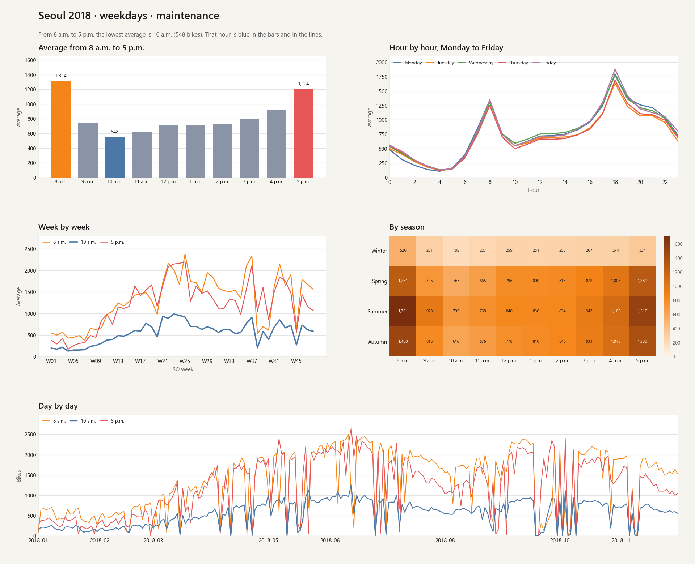
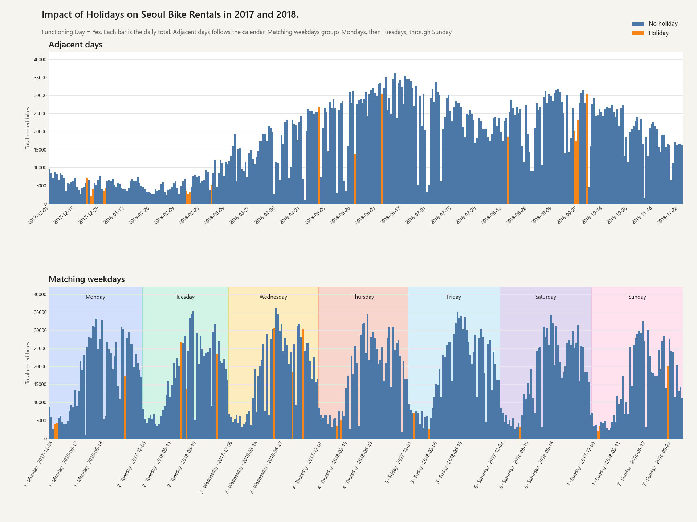
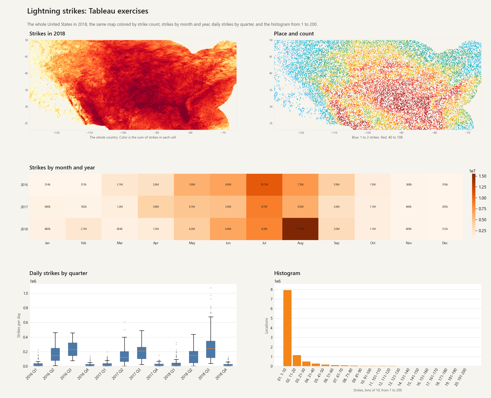
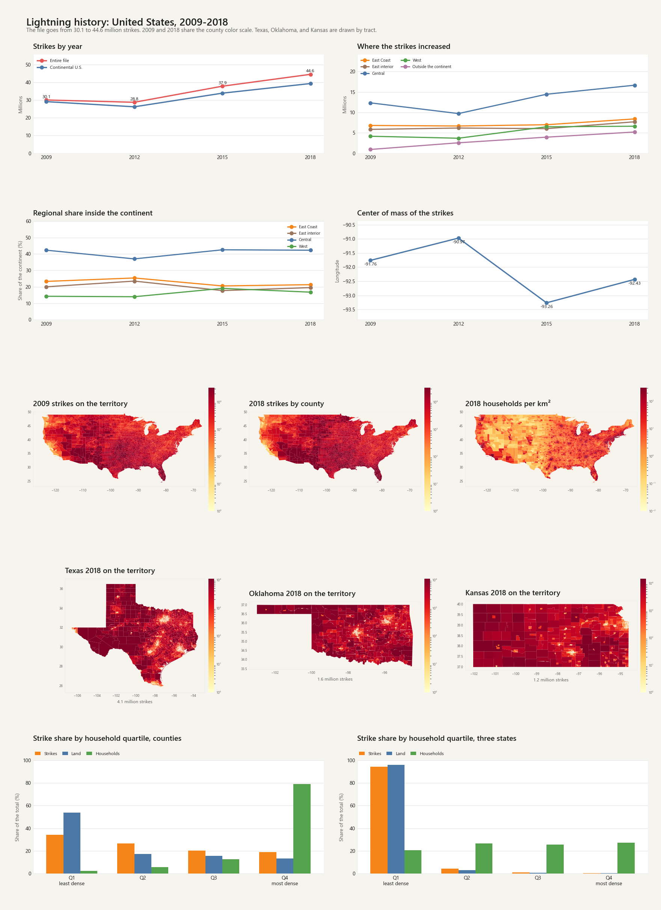
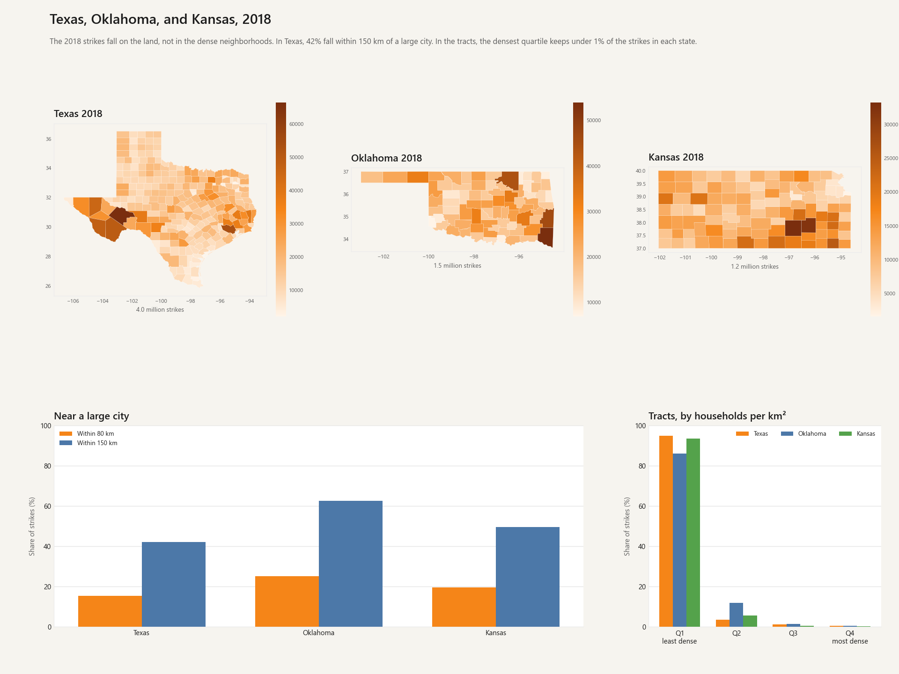
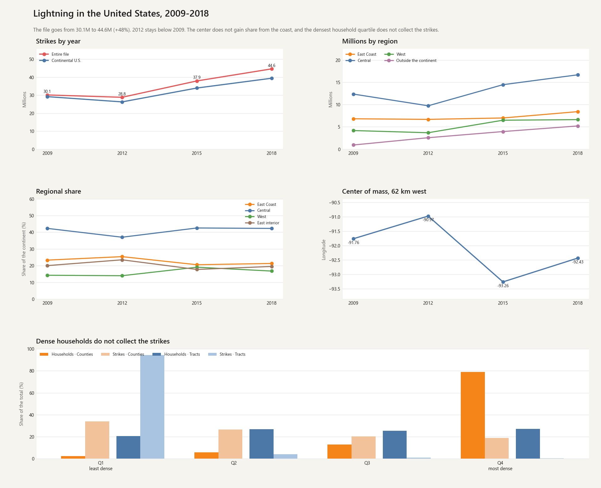

# ApacheWork

Two studies, in separate folders. They do not share data or dashboards.

## Seoul bike rentals

The notes are in [analyses/seoul_bikes/README.md](analyses/seoul_bikes/README.md).

### 1. Maintenance, 2018

On weekdays, between 8 a.m. and 5 p.m., the hour with the fewest rentals is **10 a.m.**: 548 bikes on average, and the lowest hour on 171 of 240 days.



### 2. Holidays, 2017 and 2018

**Impact of Holidays on Seoul Bike Rentals in 2017 and 2018.** Only days with Functioning Day = Yes. Each bar is the daily total. A holiday averages 12,700 bikes and a regular day 17,727, 28.4% fewer. Adjacent days follows the calendar. Matching weekdays groups each weekday and marks it with a color through the last day.



## Lightning in the United States

The notes are in [analyses/lightning/README.md](analyses/lightning/README.md).

### 1. Lightning strikes: Tableau exercises

The whole United States in 2018. Color is the sum of strikes in each cell. Beside it, the same map colored by count: blue for 1 to 2 strikes, red for 40 to 108. Below, strikes by month and year, daily strikes by quarter, and the histogram of strikes from 1 to 200.



### 2. Lightning history: United States, 2009-2018

The file goes from **30.1 to 44.6 million** strikes. The county maps compare 2009 and 2018 on the same scale. Texas, Oklahoma, and Kansas are drawn by tract: 4.1, 1.6, and 1.2 million strikes. In the counties, the densest quartile holds 79% of households and 19% of strikes. In the tracts of the three states, that quartile holds under 1% of the strikes.



### 3. Texas, Oklahoma, and Kansas, 2018

Strikes in these three states fall on the land, not in the dense neighborhoods. In Texas, **42%** fall within 150 km of a large city. In the tracts, the quartile with the most households per km² keeps under **1%** of the strikes in each state.



### 4. Summary, 2009-2018

The file goes from **30.1 to 44.6 million** strikes (+48%). 2012 stays below 2009. The center does not gain share from the coast, and the county quartile with the most households per km² holds 79% of households and only 19% of strikes.



## How it is built

Python filters and aggregates. Superset only draws those tables. Each study lives in its own folder.

```
analyses/seoul_bikes/     bikes: maintenance, holidays, and figures
analyses/lightning/       lightning: totals, territory, maps, and figures
deploy/superset.md        how to start the local Superset
```

The lightning maps use one basemap, OpenStreetMap through MapLibre. Color sits above the place names. The tooltip shows latitude, then longitude.

## Environment

Python 3.11. Dependencies are in `requirements.txt`.

```powershell
python -m venv .venv
.\.venv\Scripts\Activate.ps1
python -m pip install -r requirements.txt
```

The source CSVs are not in this repository. Each study's README gives the path on this machine.

## Superset

The Apache Superset clone and the Docker disk stay out of git. The startup guide is [deploy/superset.md](deploy/superset.md).

## What this repository leaves out

- The upstream Superset tree and `docker-data/`.
- The bike microdata.
- The lightning microdata, the Census Bureau extracts, and the generated polygons.
- The local practice gym in `practice/` and `Docs/`.
