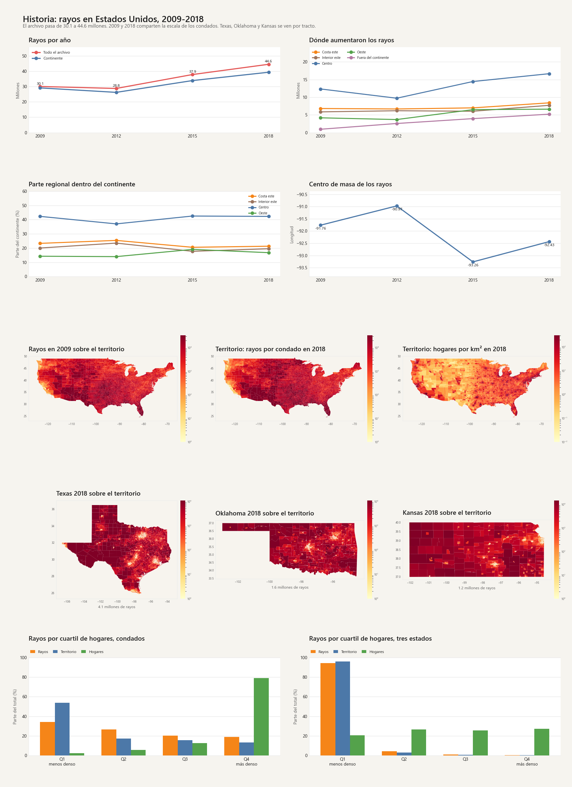
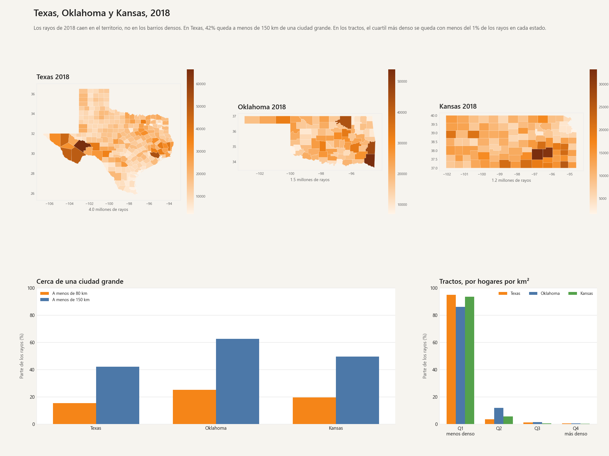
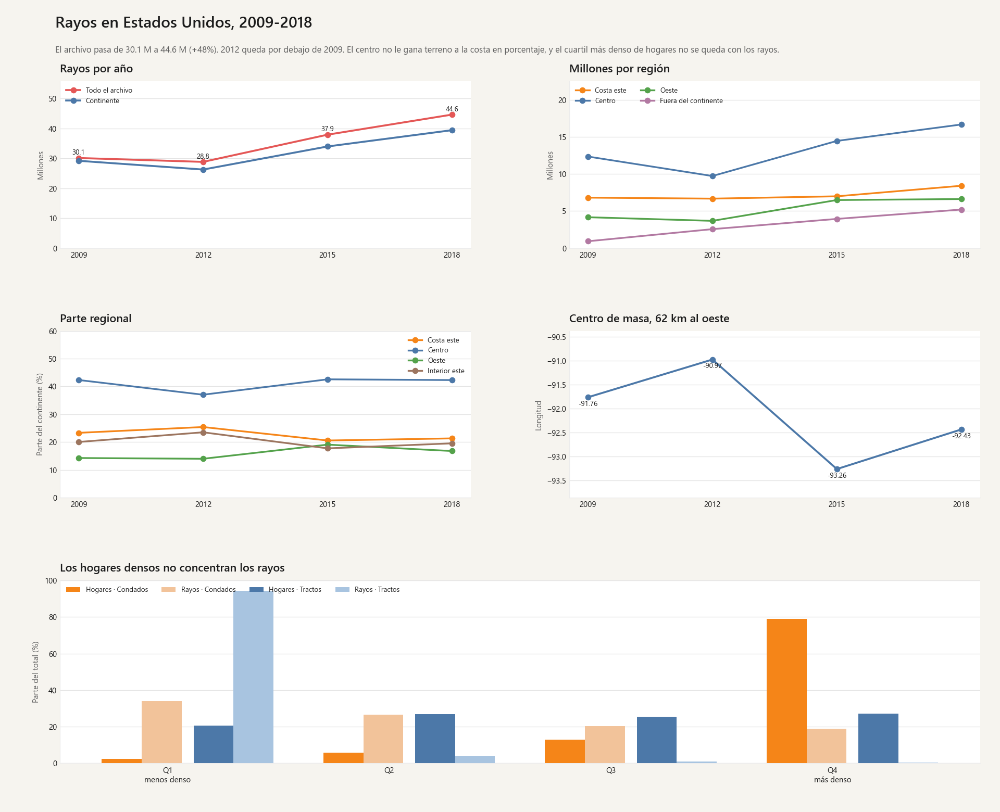

# ApacheWork

Dos estudios, en carpetas distintas. No comparten datos ni tableros.

## Bicicletas en Seúl

El detalle está en [analyses/seoul_bikes/README.md](analyses/seoul_bikes/README.md).

### 1. Mantenimiento, 2018

En los días hábiles, entre las 8 a.m. y las 5 p.m., la hora con menos alquileres es las **10 a.m.**: 548 bicicletas de promedio, y la más baja en 171 de 240 jornadas.


### 2. Feriados, 2017 y 2018

**Impact of Holidays on Seoul Bike Rentals in 2017 and 2018.** Solo días con Functioning Day = Yes. Cada barra es el total del día. Un feriado promedia 12,700 bicicletas y un día común 17,727, un 28.4% menos. Adjacent days sigue el calendario. Matching weekdays junta cada día de la semana y lo marca con un color hasta el último día.


## Rayos en Estados Unidos

El detalle está en [analyses/lightning/README.md](analyses/lightning/README.md).

### 1. Lightning strikes: ejercicios de Tableau

Todo Estados Unidos en 2018. El calor es la suma de rayos de cada celda. Al lado, el mismo mapa con el color según la cantidad: azul de 1 a 2 rayos, rojo de 40 a 108. Abajo, strikes por mes y año, la caja diaria por trimestre y el histograma de strikes entre 1 y 200.


### 2. Historia: rayos en Estados Unidos, 2009-2018

El archivo pasa de **30.1 a 44.6 millones**. Los mapas de condado comparan 2009 y 2018 en la misma escala. Texas, Oklahoma y Kansas se ven por tracto: 4.1, 1.6 y 1.2 millones de rayos. En los condados, el cuartil más denso se queda con el 79% de los hogares y el 19% de los rayos. En los tractos de los tres estados, ese cuartil se queda con menos del 1% de los rayos.



### 3. Texas, Oklahoma y Kansas, 2018

Los rayos de estos tres estados caen en el territorio, no en los barrios densos. En Texas, el **42%** queda a menos de 150 km de una ciudad grande. En los tractos, el cuartil con más hogares por km² se queda con menos del **1%** de los rayos en cada estado.



### 4. Resumen, 2009-2018

El archivo pasa de **30.1 a 44.6 millones** de rayos (+48%). 2012 queda por debajo de 2009. El centro no le gana terreno a la costa en porcentaje, y el cuartil de condados con más hogares por km² se queda con el 79% de los hogares y solo el 19% de los rayos.



## Cómo está armado

Python filtra y agrega. Superset solo dibuja esas tablas. Cada estudio vive en su carpeta.

```
analyses/seoul_bikes/     bicicletas: mantenimiento, feriados e imágenes
analyses/lightning/       rayos: totales, territorio, mapas e imágenes
deploy/superset.md        cómo levantar el Superset local
```

Los mapas de rayos usan un solo fondo, OpenStreetMap con MapLibre. El color va encima de los nombres. El tooltip muestra latitud y después longitud.

## Entorno

Python 3.11. Dependencias en `requirements.txt`.

```powershell
python -m venv .venv
.\.venv\Scripts\Activate.ps1
python -m pip install -r requirements.txt
```

Los CSV de origen no están en el repositorio. La ruta de cada archivo está en el README de su estudio.

## Superset

El clon de Apache Superset y el disco de Docker quedan fuera de git. La guía de arranque está en [deploy/superset.md](deploy/superset.md).

## Qué no entra en este repositorio

- El árbol upstream de Superset y `docker-data/`.
- El microdato de bicicletas.
- El microdato de rayos, los extractos del Census Bureau y los polígonos generados.
- El gimnasio de práctica que está en `practice/` y `Docs/` en la máquina local.
